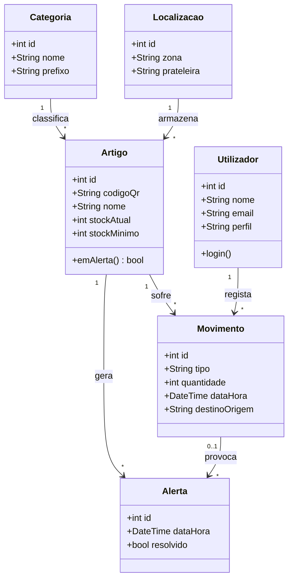
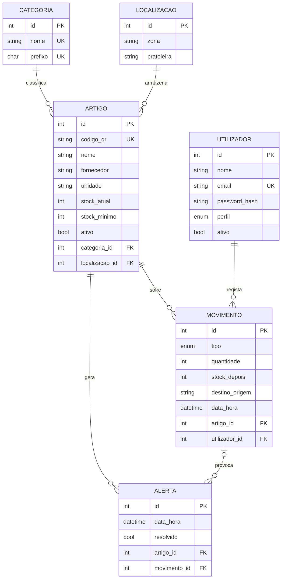

# Diagrama de classes e modelo ER · ES Stock

## Diagrama de classes (conceptual)

## Modelo entidade-relação

## Organização do código (MVC)

| Camada | Servidor (Node.js) | App (Flutter) |
|---|---|---|
| Model | `src/models/` (acesso à BD) | `lib/models/` (classes Artigo, Movimento, Estatistica) |
| Controller | `src/controllers/` (regras e respostas HTTP) | `lib/controllers/` (dados em memória e chamadas à API) |
| View / rotas | `src/routes/` (endpoints JSON) | `lib/views/` (ecrãs e widgets) |
| Serviços | `src/middleware/` (token, erros) | `lib/services/api_service.dart` (pedidos HTTP) |
